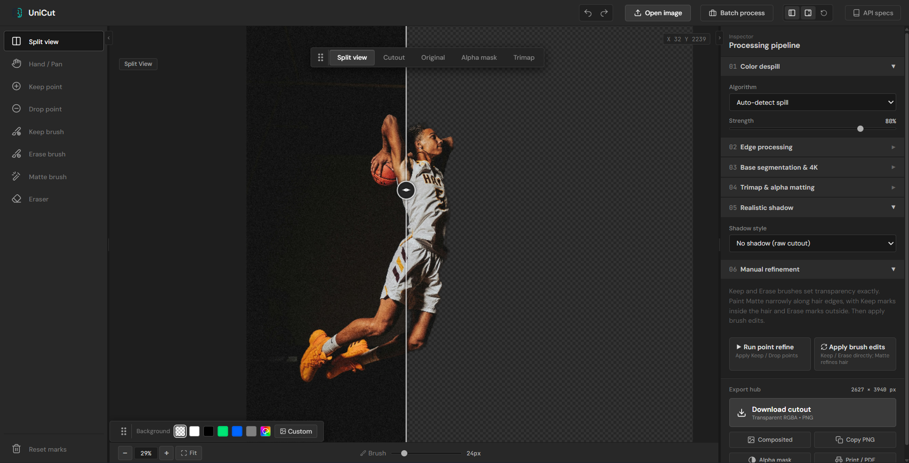
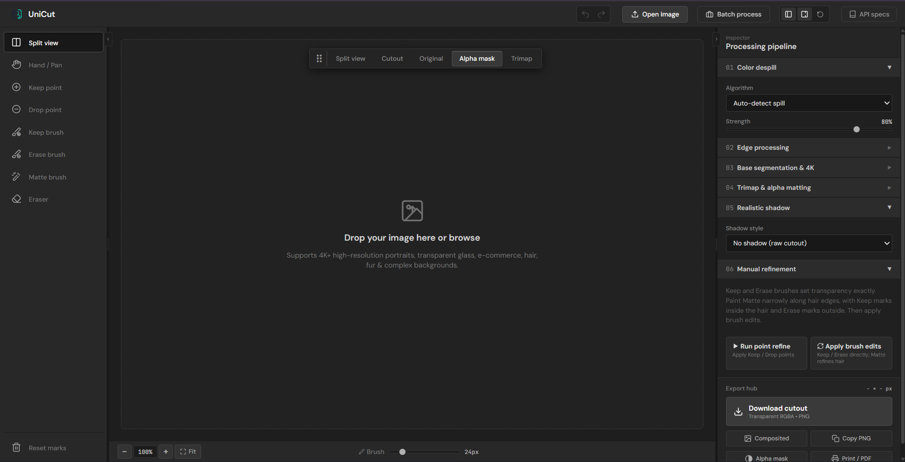
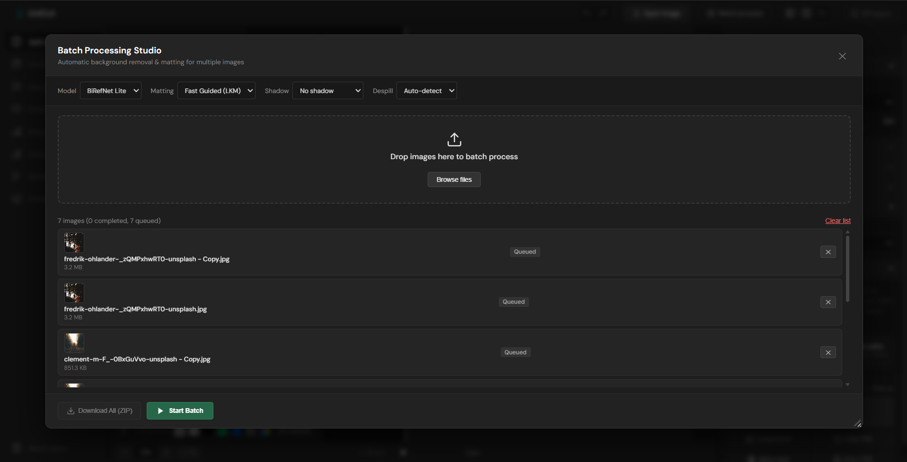
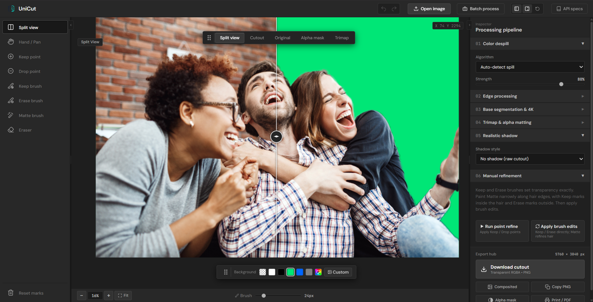
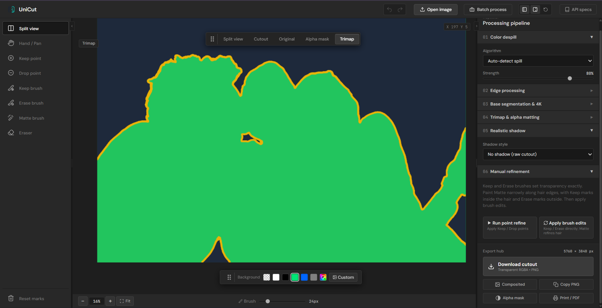

# UniCut

Remove image backgrounds on your own computer, with batch processing and manual tools for difficult edges and hair.

[](LICENSE)

## Preview

### Compare the original and cutout

Use the split-view slider to inspect the original photo alongside the transparent-background result.



<details>
<summary>More screenshots: workspace, batch processing, backgrounds, and trimap</summary>

### The workspace

Upload an image, choose a view, and access the refinement tools and processing controls in one workspace.



### Batch processing

Queue multiple images and choose shared processing settings before starting the batch.



### Background previews

Check your cutout against different background colors before exporting it.



### Trimap inspection

Inspect foreground regions and uncertain edges in the trimap view when refining a result.



</details>

## Start using UniCut

### Windows: download and double-click

1. Install [Docker Desktop](https://www.docker.com/products/docker-desktop/) and open it. Wait until Docker is running.
2. [Download UniCut](https://github.com/N0AH205/UniCut/archive/refs/heads/main.zip) and **extract the ZIP**.
3. Open the extracted folder and double-click **Start UniCut.bat**.

The first setup downloads the software and can take several minutes. Your browser opens when the app is ready. No Python, Git, or Node.js setup is needed.

Upload a photo, inspect the result, and choose **Download cutout**. When finished, double-click **Stop UniCut.bat**. Downloaded AI model files are kept for next time.

### macOS / Linux, or using a terminal

Install Docker Desktop (or Docker Engine with Compose on Linux), download and extract UniCut, then open a terminal in that folder and run:

```bash
docker compose up --build --wait --wait-timeout 300
```

Open **http://127.0.0.1:7860**. To stop the app:

```bash
docker compose stop
```

## What you can do

- Remove backgrounds with BiRefNet Lite and optional alpha matting.
- Process a batch of images and download a ZIP.
- Correct edges with Keep, Erase, and Matte brushes or keep/drop points.
- Compare the original, cutout, and alpha mask; use different backgrounds.
- Undo/Redo edits, adjust edges and color spill, and add optional generated shadows.

## Troubleshooting

**Docker is not running:** open Docker Desktop and wait for it to finish starting. On Windows, use Linux containers.

**Port 7860 is already in use:** stop the other copy of UniCut. In PowerShell, you can also start on another port:

```powershell
$env:UNICUT_PORT = "7861"
docker compose up --build --wait --wait-timeout 300
```

Then open http://127.0.0.1:7861.

**Something else went wrong:** run `docker compose logs --tail 100` in the UniCut folder and include the error when [reporting a bug](https://github.com/N0AH205/UniCut/issues). Do not share private photos or credentials.

## Developers

For Python installation, tests, Docker checks, and the REST API, see [the developer guide](docs/DEVELOPMENT.md). There is no frontend build step. Contributions are welcome; see [CONTRIBUTING.md](CONTRIBUTING.md).

## License

Original UniCut code is available under the [MIT License](LICENSE), copyright Noah Stephen. Third-party models, libraries, fonts, and bundled components retain their own licenses; see [THIRD_PARTY_NOTICES.md](THIRD_PARTY_NOTICES.md).

The model is [BiRefNet Lite ONNX](https://huggingface.co/onnx-community/BiRefNet_lite-ONNX), listed under MIT. Weights are downloaded separately and are not baked into the Docker image. The [upstream BiRefNet notice](licenses/BiRefNet-MIT.txt) is included.
